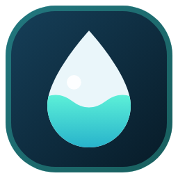
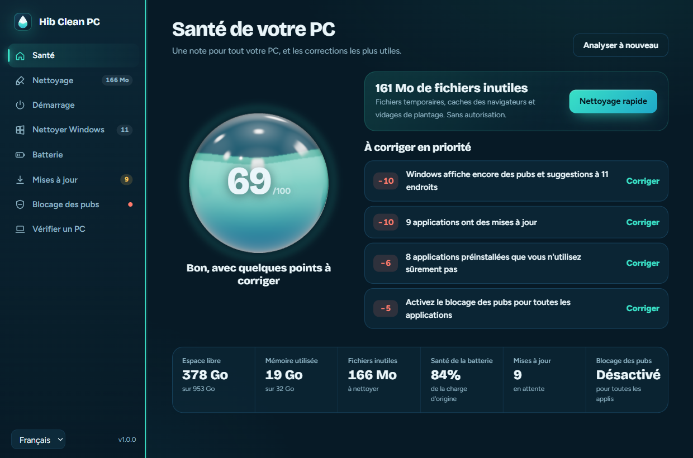
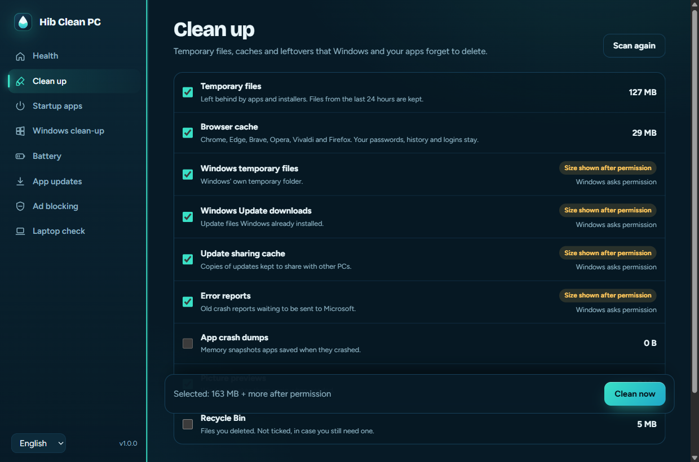
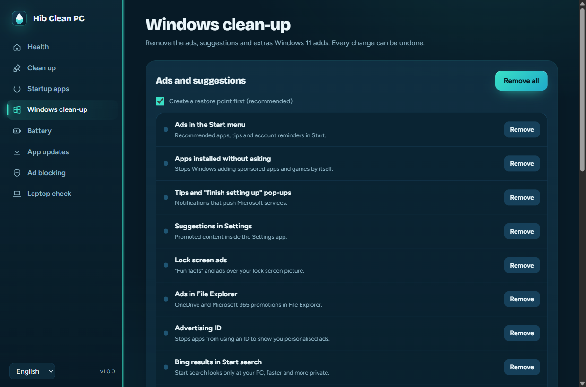
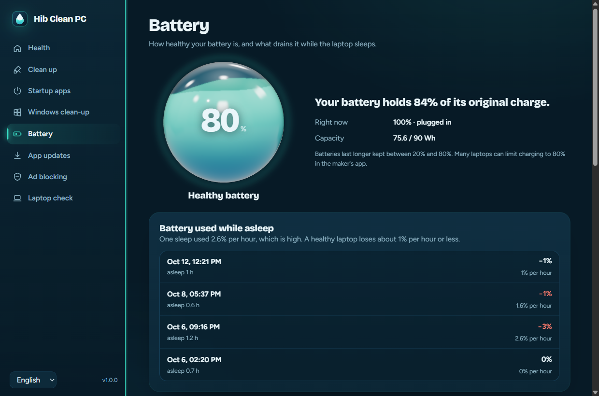
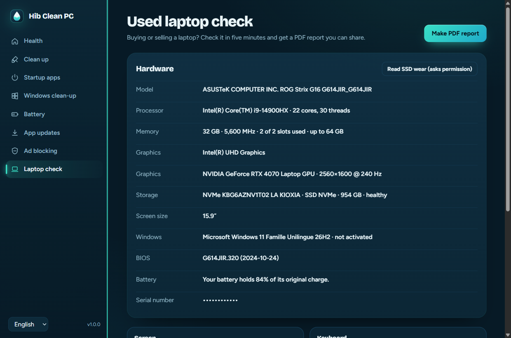

<div align="center">



# Hib Clean PC

**A free, open-source clean-up and health app for Windows 11 and 10.**<br>
One health score for your PC, junk files cleaned, Windows ads removed, battery explained, apps updated and ads blocked in every app.

[](#install)
[](https://github.com/ZakariaHibaoui2/hib-clean-pc/releases/latest/download/HibCleanPC.exe)

[](https://github.com/ZakariaHibaoui2/hib-clean-pc/releases/latest)
[](https://github.com/ZakariaHibaoui2/hib-clean-pc/actions/workflows/ci.yml)
[](LICENSE)

English · Français · العربية

<br>



</div>

## What it does

| | |
|---|---|
| **PC health score** | A 3D glass orb that fills to your score from 0 to 100, the fixes that matter most, and **Quick clean** for the junk that needs no permission. |
| **Clean up** | Temporary files, browser caches, old Windows Update files, error reports and the Recycle Bin. Files from the last 24 hours and anything in use are left alone, and your passwords, history and logins stay. |
| **Startup apps** | Every app that starts with Windows, with an on/off switch. It's the same switch Task Manager uses, so nothing is deleted. |
| **Windows clean-up** | Turns off 11 kinds of Windows 11 ads and suggestions (Start, lock screen, Settings, File Explorer, Bing in search, Copilot…), and opens the Widgets switch in Settings and removes pre-installed junk apps. Every change can be undone, and it can make a restore point first. |
| **Battery** | Battery health in plain words ("holds 84% of its original charge"), how much it drained in each recent sleep, what woke the laptop, and which devices are allowed to wake it. |
| **App updates** | Updates all your apps in one click with winget, Windows' own installer. |
| **Ad blocking for every app** | One switch sets AdGuard DNS, which blocks ads and trackers in every app and game, not just the browser. Quad9 and Cloudflare are offered too, and "Automatic" puts back exactly what you had. |
| **Used laptop check** | Before buying or selling a laptop: model, processor, RAM slots, SSD health and wear, battery health, Windows activation, plus screen, keyboard, camera, microphone and speaker tests. Then a PDF report to share. |

<table>
<tr>
<td></td>
<td></td>
</tr>
<tr>
<td></td>
<td></td>
</tr>
</table>

## Install

### One command (no warning)

Open **PowerShell** (press the Windows key, type `powershell`, press Enter) and paste:

```powershell
irm https://zakariahibaoui2.github.io/hib-clean-pc/install.ps1 | iex
```

It downloads the latest version from this repository into your user folder, adds Start menu and Desktop shortcuts, and lists Hib Clean PC in **Settings → Apps** so you can uninstall it like any app. No administrator rights are needed to install. You can [read the script](docs/install.ps1) first.

### Or download the app

Download **[HibCleanPC.exe](https://github.com/ZakariaHibaoui2/hib-clean-pc/releases/latest/download/HibCleanPC.exe)** and run it; it works without installing. Windows may show "Windows protected your PC" because the app isn't signed with a paid certificate: click **More info**, then **Run anyway**. The one-command install avoids this.

Needs Windows 10 or 11 with Microsoft Edge WebView2, which Windows 11 already has.

## Safe by design

- **It asks before changing Windows.** The app opens without administrator rights. Actions that change system settings (like cleaning Windows' own folders, ad blocking or widgets) show Windows' permission prompt each time, and nothing changes if you say No.
- **Every Windows change can be undone.** Before changing a setting it saves the old value, and Undo puts exactly that back. DNS "Automatic" restores what your PC used before.
- **It only deletes inside known cache folders.** It never follows shortcuts or junctions out of them, refuses to touch drive or profile roots, and skips files from the last 24 hours and files in use. This is covered by tests in [`tests/test_scripts.py`](tests/test_scripts.py).
- **Apps are removed only for you,** and only from a fixed list of promo apps. Windows' own apps (Store, Calculator…) can't be removed. Each one can be reinstalled from the Microsoft Store.
- **No account, no tracking, no ads.** The app sends nothing anywhere. The only network use is winget checking for updates when you open App updates, and the "ad blocked" DNS test. See [PRIVACY.md](PRIVACY.md).
- **Open source.** Every action is a short PowerShell script in [`scripts/`](scripts) that you can read.

## How it's built

| Part | What it does | Where |
|---|---|---|
| App host | A small C# program that opens a WebView2 window and runs only the bundled scripts. Arguments travel as base64 JSON, never as command-line text. | [`app/HibCleanPC.cs`](app/HibCleanPC.cs) |
| Scripts | One PowerShell script per feature, returning JSON. | [`scripts/`](scripts) |
| Interface | HTML, CSS and JavaScript with no framework, in English, French and Arabic (right to left). | [`ui/`](ui) |

## Build and test

```sh
python tools/build.py              # dist/HibCleanPC.exe, using the C# compiler built into Windows
python tests/test_scripts.py       # the scripts, against a sandbox folder and a test registry key
python tests/test_app.py           # launches the real app read-only and visits every screen
python tests/test_install.py       # installs, checks shortcuts and Settings > Apps, uninstalls
python tests/test_accuracy.py      # every number checked against an independent source (registry, Python, raw tool output)
node tests/score.test.mjs          # the health score, exact results for known situations
python tests/test_admin.py         # the features that need admin rights, for real, then everything put back (asks permission once)
```

On the development PC: 38 script checks, 49 accuracy checks, 36 app checks, 10 install checks and 13 admin checks, all passing. The tests never change your settings: changes run in a sandbox folder and a throwaway registry key, and the app test runs the app in a read-only mode that refuses every action.

## Also from Hib

**[Hib Remover Ads](https://github.com/ZakariaHibaoui2/hib-remover-ads)**: a free, open-source ad blocker for Chrome, Edge, Brave and Opera.

## License

Made by [Zakaria Hibaoui](https://github.com/ZakariaHibaoui2). Licensed under [GPL-3.0](LICENSE). Fonts: [Bricolage Grotesque](https://github.com/ateliertriay/bricolage) and [Figtree](https://github.com/erikdkennedy/figtree), SIL Open Font License. Uses Microsoft Edge WebView2.

Hib Clean PC is an independent project and isn't affiliated with Microsoft, AdGuard, Quad9 or Cloudflare.
