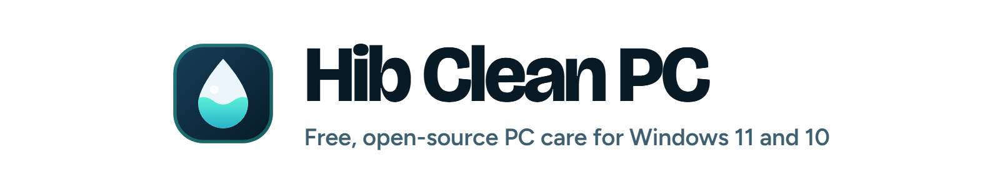
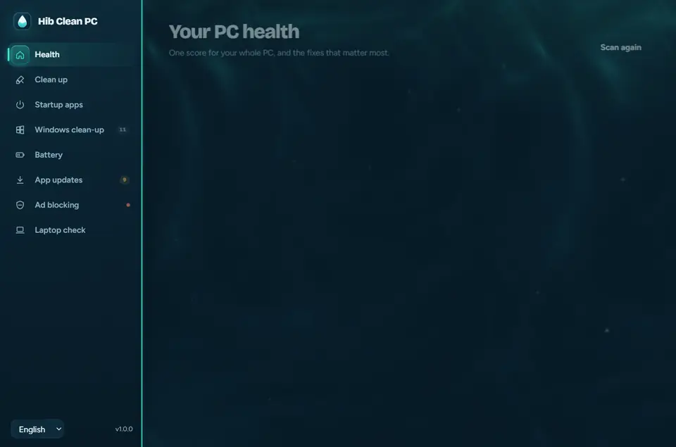
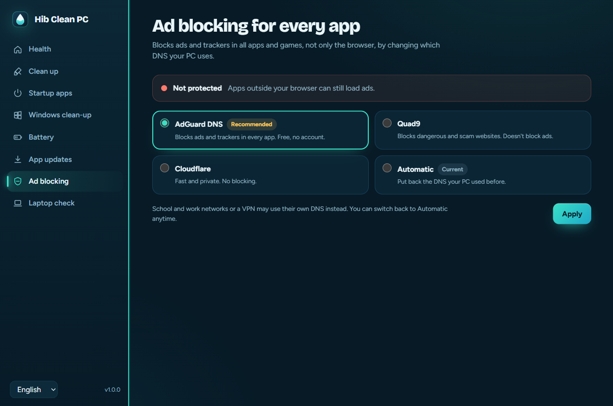
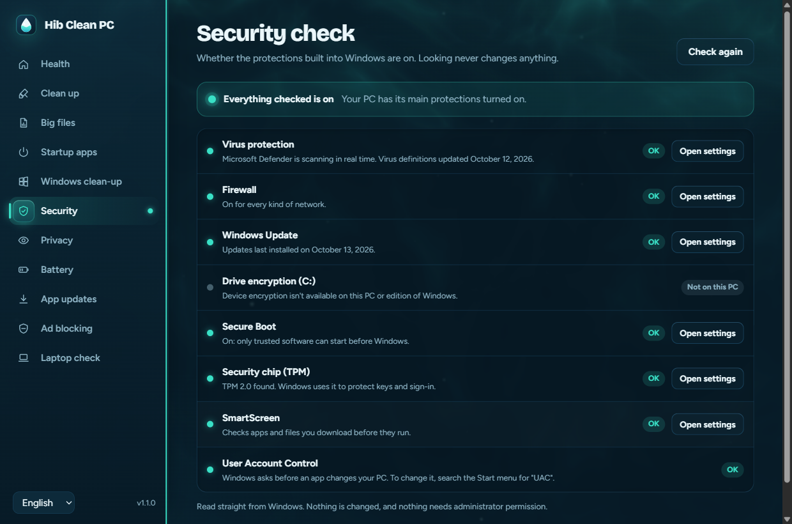
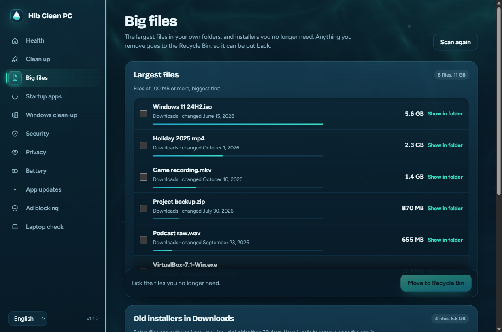
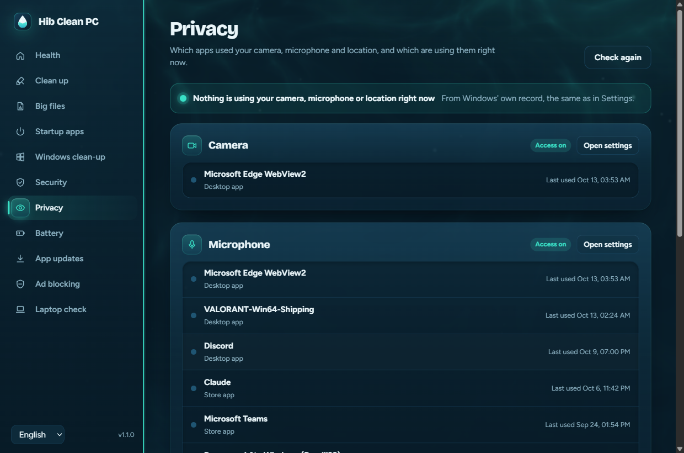
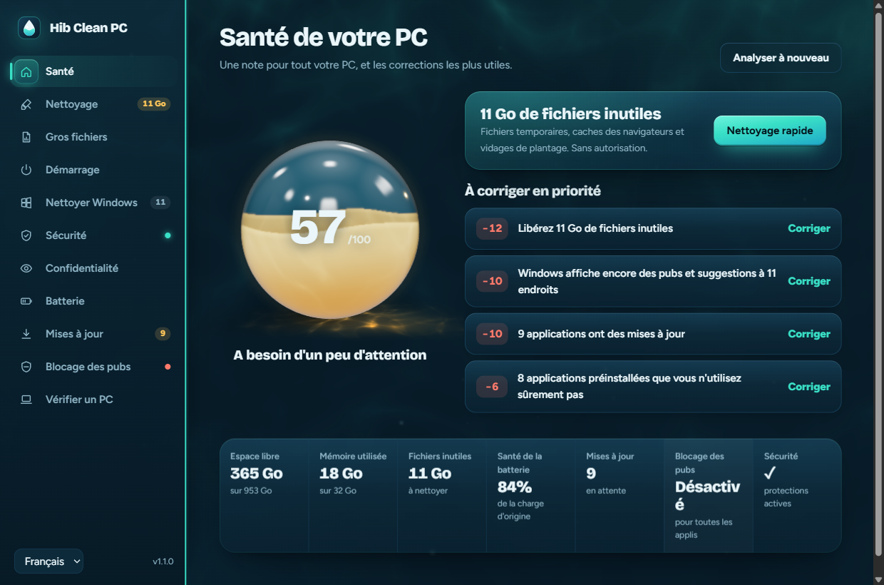
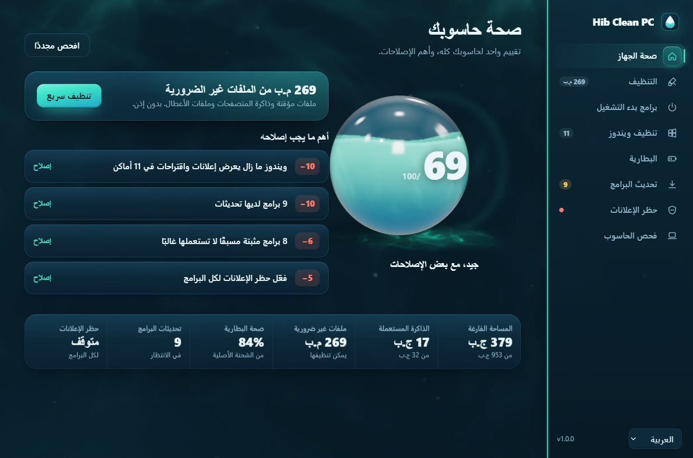

<div align="center">

<picture>
  <source media="(prefers-color-scheme: dark)" srcset="assets/readme/banner-dark.png">
  <source media="(prefers-color-scheme: light)" srcset="assets/readme/banner-light.png">
  
</picture>

### One health score for your PC, then the fixes that matter.

Junk cleaned, Windows ads off, security checked, big files found, battery explained<br>and ads blocked in every app. Every change can be undone.

<br>

<a href="https://github.com/ZakariaHibaoui2/hib-clean-pc/releases/latest/download/HibCleanPC.exe"></a>&nbsp;
<a href="#install"></a>&nbsp;
<a href="https://zakariahibaoui2.github.io/hib-clean-pc/"></a>

<br><br>

[](https://github.com/ZakariaHibaoui2/hib-clean-pc/actions/workflows/ci.yml)
[](https://github.com/ZakariaHibaoui2/hib-clean-pc/releases/latest)
[](https://github.com/ZakariaHibaoui2/hib-clean-pc/releases)
[](#install)
[](#screens)
[](LICENSE)

<br>



<sub>No account, no ads, no telemetry. Runs without administrator rights and asks Windows before it changes anything.<br>Works on any Windows 10 or 11 PC: desktop, laptop, tablet or touch screen, x64 or ARM64.</sub>

</div>

<br>

## What it does

<table>
<tr>
<td width="50%" valign="top">

<b>PC health score</b><br>
A 3D glass orb that fills to your score from 0 to 100 (it also counts real-time protection and the firewall), the fixes that help most, and <b>Quick clean</b> for the junk that needs no permission.
</td>
<td width="50%" valign="top">

<b>Clean up</b><br>
Temporary files, browser caches, old Windows Update files, error reports, crash dumps, picture previews and the Recycle Bin. Your passwords, history and logins stay.
</td>
</tr>
<tr>
<td valign="top">

<b>Startup apps</b><br>
Every app that starts with Windows, with the same on/off switch Task Manager uses. Nothing is uninstalled.
</td>
<td valign="top">

<b>Windows clean-up</b><br>
Turns off 11 kinds of Windows 11 ads and suggestions (Start, lock screen, Settings, File Explorer, Bing in search, Copilot…) and removes pre-installed promo apps.
</td>
</tr>
<tr>
<td valign="top">

<b>Battery</b><br>
Health in plain words ("holds 84% of its original charge"), how much each sleep drained, what woke the laptop and which devices may wake it.
</td>
<td valign="top">

<b>App updates</b><br>
Updates all your apps in one click with winget, the installer built into Windows.
</td>
</tr>
<tr>
<td valign="top">

<b>Ad blocking for every app</b><br>
One switch sets AdGuard DNS, so apps and games lose their ads too, not just the browser. Quad9 and Cloudflare are offered, and "Automatic" puts back exactly what you had.
</td>
<td valign="top">

<b>Used laptop check</b><br>
Before buying or selling: model, processor, RAM slots, SSD health and wear, battery, Windows activation, plus screen, keyboard, camera, mic and speaker tests. Then a PDF report.
</td>
</tr>
<tr>
<td valign="top">

<b>Security check</b> <sup>new in 1.1</sup><br>
Defender real-time protection and how old its definitions are, the firewall for each network type, Windows Update, drive encryption, Secure Boot, TPM, SmartScreen and UAC. Each one has an <b>Open settings</b> button. No admin rights needed.
</td>
<td valign="top">

<b>Big files</b> <sup>new in 1.1</sup><br>
Files of 100 MB or more in Downloads, Desktop, Documents, Videos, Pictures and Music (OneDrive folders included), plus old installers in Downloads. <b>Show in folder</b>, or move them to the Recycle Bin, never deleted for good.
</td>
</tr>
<tr>
<td valign="top">

<b>Privacy</b> <sup>new in 1.1</sup><br>
Which apps used your camera, microphone and location recently, and which are using them right now, with links to the matching Privacy settings.
</td>
<td valign="top">

<b>Undo for everything it changes</b><br>
Every Windows setting is saved before it changes, so Undo puts exactly it back. Windows clean-up can make a restore point first.
</td>
</tr>
</table>

## Screens

<table>
<tr>
<td width="50%"><br><sub><b>Clean up</b>: see what each category holds before anything is deleted.</sub></td>
<td width="50%"><br><sub><b>Windows clean-up</b>: ads and suggestions off, each one undoable.</sub></td>
</tr>
<tr>
<td><br><sub><b>Battery</b>: health in plain words and drain during sleep.</sub></td>
<td><br><sub><b>Ad blocking</b>: AdGuard DNS for every app, and "Automatic" to go back.</sub></td>
</tr>
<tr>
<td><br><sub><b>Security check</b> <sup>new in 1.1</sup>: what protects your PC, in plain words.</sub></td>
<td><br><sub><b>Big files</b> <sup>new in 1.1</sup>: the largest files, moved to the Recycle Bin only.</sub></td>
</tr>
<tr>
<td><br><sub><b>Privacy</b> <sup>new in 1.1</sup>: who used your camera, mic and location.</sub></td>
<td><br><sub><b>Used laptop check</b>: everything a buyer should see, then a PDF report.</sub></td>
</tr>
<tr>
<td><br><sub><b>In French</b>: every screen is translated.</sub></td>
<td><br><sub><b>In Arabic</b>: the whole app, right to left.</sub></td>
</tr>
</table>

## Install

Needs Windows 10 or 11 with Microsoft Edge WebView2, which Windows 11 already has. No administrator rights are needed to install.

It runs on any Windows PC: desktops, laptops, tablets and 2-in-1s, on Intel, AMD or ARM (x86, x64 and ARM64). The window adapts to small screens with an icon rail, scales sharply on every monitor, and works with touch, pen, keyboard and high-contrast mode.

### Option 1: one command (recommended)

Open **PowerShell** (press the Windows key, type `powershell`, press Enter) and paste:

```powershell
irm https://zakariahibaoui2.github.io/hib-clean-pc/install.ps1 | iex
```

It downloads the latest `HibCleanPC.exe` from this repository's [Releases](https://github.com/ZakariaHibaoui2/hib-clean-pc/releases) into `%LOCALAPPDATA%\Programs\Hib Clean PC`, adds Start menu and Desktop shortcuts, and lists Hib Clean PC in **Settings → Apps** so you can uninstall it like any app. You can [read the script](docs/install.ps1) before running it.

### Option 2: download the app

Download **[HibCleanPC.exe](https://github.com/ZakariaHibaoui2/hib-clean-pc/releases/latest/download/HibCleanPC.exe)** from the [latest release](https://github.com/ZakariaHibaoui2/hib-clean-pc/releases/latest) and run it. It works without installing.

> [!NOTE]
> **About the "Windows protected your PC" warning.** The app isn't signed with a paid code-signing certificate, and Microsoft Defender SmartScreen warns about unsigned apps it hasn't seen downloaded many times before. The warning doesn't mean anything harmful was found. Click **More info**, then **Run anyway**.
>
> The one-command install doesn't show this warning because files downloaded by PowerShell aren't marked as coming from the internet the way browser downloads are. That also means the check is up to you: you can read the [install script](docs/install.ps1) and the [source](app/HibCleanPC.cs), and compare the file's SHA-256 with the one listed in each release:
>
> ```powershell
> (Get-FileHash .\HibCleanPC.exe -Algorithm SHA256).Hash
> ```
>
> Every release is built from its tagged source by the [Release workflow](.github/workflows/release.yml) on GitHub Actions.

### Uninstall

Open **Settings → Apps**, find **Hib Clean PC** and click **Uninstall**. The two small undo files are kept, so changes the app made can still be undone if you install it again (see [PRIVACY.md](PRIVACY.md)).

## Safe by design


- **Scans are read-only.** Opening a screen only reads your PC; nothing changes until you click a button that says what it will do.
- **It asks before changing Windows.** The app runs without administrator rights. Actions that change system settings (like cleaning Windows' own folders, ad blocking or widgets) show Windows' own permission prompt (UAC) each time, and nothing changes if you say No.
- **Every Windows change can be undone.** Before changing a setting it saves the old value, and Undo puts exactly that back. DNS "Automatic" restores what your PC used before. Windows clean-up can make a **system restore point** first.
- **Big files go to the Recycle Bin, never further.** The Big files screen can only move a file to the Recycle Bin, so you can always restore it.
- **It only deletes inside known cache folders.** It never follows shortcuts or junctions out of them, refuses to touch drive or profile roots, and skips files from the last 24 hours and files in use. This is covered by tests in [`tests/test_scripts.py`](tests/test_scripts.py).
- **Apps are removed only for you,** and only from a fixed list of promo apps. Windows' own apps (Store, Calculator…) can't be removed. Each one can be reinstalled from the Microsoft Store.
- **It runs only its own scripts.** The app host runs only the PowerShell scripts bundled inside it, by name, and nothing else. Arguments travel as base64 JSON, never as command-line text.
- **Open source.** Every action is a short PowerShell script in [`scripts/`](scripts) that you can read.

## How it's tested

Seven test suites run against the real app, the real scripts and real Windows:

| Suite | What it checks | Checks |
|---|---|---:|
| [`test_scripts.py`](tests/test_scripts.py) | Every script, against a sandbox folder and a throwaway registry key, including the cleaner's safety rules | 62 |
| [`test_accuracy.py`](tests/test_accuracy.py) | Every number the app shows, compared with an independent source (the registry, Python, raw tool output) | 98 |
| [`test_app.py`](tests/test_app.py) | Launches the real app in a read-only mode and visits every screen | 62 |
| [`test_devices.py`](tests/test_devices.py) | Every screen at small-laptop to 4K and tablet-portrait sizes, in all three languages: touch and pen, high DPI, high contrast, reduced motion, keyboard only and the ARM build | 70 |
| [`test_install.py`](tests/test_install.py) | Installs, checks the shortcuts and Settings → Apps entry, then uninstalls | 10 |
| [`test_admin.py`](tests/test_admin.py) | The features that need admin rights, for real, then everything put back exactly as it was | 13 |
| [`score.test.mjs`](tests/score.test.mjs) | The health score: exact results for known situations | 24 |

All passing on the development PC. The tests never leave your settings changed: changes run in a sandbox folder and a throwaway registry key, the app test runs the app in a mode that refuses every action, and the admin test restores everything it touches.

[Continuous integration](.github/workflows/ci.yml) runs on every push and pull request: it checks that the JavaScript and every PowerShell script parse, that all three languages have every string, runs the health score test, builds the app and runs the script tests.

## FAQ

<details>
<summary><b>Is it really free?</b></summary>
<br>
Yes. There's no paid version, no account and no ads. The code is here under GPL-3.0.
</details>

<details>
<summary><b>Will cleaning delete my files?</b></summary>
<br>
No. It only cleans caches and temporary files that apps and Windows recreate. Your documents, photos, passwords and browser history stay. Files from the last 24 hours and files in use are skipped, and the Recycle Bin is only emptied if you tick it.
</details>

<details>
<summary><b>Windows says "Windows protected your PC". Is it safe?</b></summary>
<br>
That warning appears for apps without a paid signing certificate when you download the <code>.exe</code> in a browser; it doesn't mean anything harmful was found. Choose <b>More info</b>, then <b>Run anyway</b>, or use the one-command install. You can check the file's SHA-256 against the one in each release.
</details>

<details>
<summary><b>Does it send anything over the internet?</b></summary>
<br>
No data about you or your PC. The only network use is winget checking for app updates when you open App updates, and a one-domain DNS lookup that shows whether ad blocking works. See <a href="PRIVACY.md">PRIVACY.md</a>.
</details>

<details>
<summary><b>Does ad blocking work on school or work Wi-Fi?</b></summary>
<br>
Some school and work networks, and VPNs, force their own DNS, so it may not apply there. You can switch back to Automatic at any time.
</details>

<details>
<summary><b>Can I undo what it changed?</b></summary>
<br>
Yes. Every Windows setting it changes is saved first, and Undo puts exactly that value back. Removed promo apps can be reinstalled from the Microsoft Store, and Windows clean-up can make a system restore point before it starts.
</details>

<details>
<summary><b>Does it work on Windows 10, on a Mac or on a phone?</b></summary>
<br>
It works on Windows 10 and 11. It doesn't run on macOS, Linux, iPhone or Android. On a phone, the <a href="https://zakariahibaoui2.github.io/hib-clean-pc/">website</a> can send the link to your PC.
</details>

<details>
<summary><b>How do I uninstall it?</b></summary>
<br>
Settings → Apps → Installed apps → Hib Clean PC → Uninstall. Undo the changes it made from inside the app first if you want Windows exactly as it was.
</details>

## How it's built

| Part | What it does | Where |
|---|---|---|
| App host | A small C# program that opens a WebView2 window and runs only the bundled scripts. | [`app/HibCleanPC.cs`](app/HibCleanPC.cs) |
| Scripts | One PowerShell script per feature, returning JSON. Written for Windows PowerShell 5.1, which every Windows PC has. | [`scripts/`](scripts) |
| Interface | HTML, CSS and JavaScript with no framework, in English, French and Arabic (right to left). | [`ui/`](ui) |
| Installer | The one-command installer and the website, served by GitHub Pages. | [`docs/`](docs) |

The result is a single `HibCleanPC.exe` with the interface, scripts and WebView2 inside it.

<details>
<summary><b>Build from source</b></summary>
<br>

You need Windows 10 or 11, Python 3.12+ and Node.js 22. The build uses the C# compiler built into Windows, so no Visual Studio or .NET SDK is needed.

```sh
python tools/build.py              # dist/HibCleanPC.exe, using the C# compiler built into Windows
node tests/score.test.mjs          # the health score, exact results for known situations
python tests/test_scripts.py       # the scripts, against a sandbox folder and a test registry key
python tests/test_accuracy.py      # every number checked against an independent source
python tests/test_app.py           # launches the real app read-only and visits every screen (needs Playwright)
python tests/test_devices.py       # every screen at many window sizes, touch, high DPI, high contrast, ARM build
python tests/test_install.py       # installs, checks shortcuts and Settings > Apps, uninstalls
python tests/test_admin.py         # admin features for real, then everything put back (asks permission once)
```

See [CONTRIBUTING.md](CONTRIBUTING.md) for details, including the C# 5 and PowerShell 5.1 limits.

</details>

## Privacy

No account, no analytics, no ads and no servers. The app sends nothing about you or your PC anywhere. The only network use is winget checking for updates when you open App updates, and the one-domain DNS lookup that shows whether ads are blocked. Undo data stays in `%LOCALAPPDATA%\Hib Clean PC`. Full details in [PRIVACY.md](PRIVACY.md).

## Contributing

- Found a bug or a wrong number? [Open an issue](https://github.com/ZakariaHibaoui2/hib-clean-pc/issues/new/choose).
- Want to help? Read [CONTRIBUTING.md](CONTRIBUTING.md) and the [Code of Conduct](CODE_OF_CONDUCT.md).
- Found a security problem? Please report it privately, as described in [SECURITY.md](SECURITY.md).

**Also from Hib:** [Hib Remover Ads](https://github.com/ZakariaHibaoui2/hib-remover-ads), a free, open-source ad blocker for Chrome, Edge, Brave and Opera.

## License

Made by [Zakaria Hibaoui](https://github.com/ZakariaHibaoui2). Licensed under [GPL-3.0](LICENSE). Fonts: [Bricolage Grotesque](https://github.com/ateliertriay/bricolage) and [Figtree](https://github.com/erikdkennedy/figtree), SIL Open Font License. 3D orb rendered with [three.js](https://threejs.org) (MIT). Uses Microsoft Edge WebView2.

Hib Clean PC is an independent project and isn't affiliated with Microsoft, AdGuard, Quad9 or Cloudflare.

<div align="center"><br><a href="#readme"><sub>Back to top</sub></a></div>
